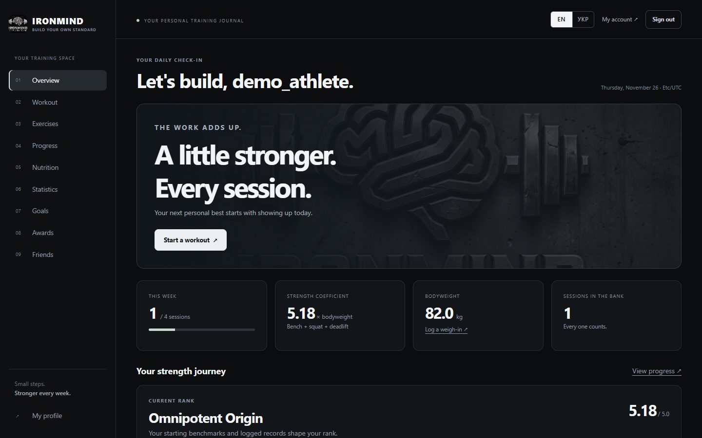

# IronMind

A personal training journal for strength work, cardio and timed holds, with progress, records, nutrition, goals and friends in one place. Built with an ASP.NET Core Web API, a React client and PostgreSQL, and shipped as one Docker image.




[Phone layout](docs/images/mobile.jpg) · [Workout logger on a phone](docs/images/workout-mobile.jpg)

## Features

**Training log**
- Log strength, cardio and timed sets with set types (working, warm-up, failure), rest, a session rating and a comment.
- Find an exercise by name or by muscle group, see the last set you logged for it, edit or remove sets, and run the session and rest timers.
- An unfinished workout survives a reload or a closed tab and continues on another device. Saving it twice, for example after a double tap, never creates a duplicate.
- Supersets and circuits keep the order in which the sets were done.

**Progress and records**
- 123 exercises in eight groups: Arms, Back, Chest, Conditioning, Core, Legs, Mobility and Shoulders.
- Personal load records, training statistics, awards and a rank based on the bench press, squat and deadlift relative to bodyweight.
- A progress tracker that compares a starting and a current result for any exercise, showing the change in each value separately.

**Nutrition, body and goals**
- A nutrition entry for any day, with personal calorie and macro targets, or optional estimates for adults.
- A weigh-in log, a weekly training plan, personal goals with deadlines, and a JSON export of your data.

**People and language**
- Friends with confirmed requests. Workouts, nutrition and progress are visible only after a request is accepted, and friends can like and comment on workouts.
- The interface is in English and Ukrainian; the choice is saved with the account.
- A small feed of research notes, each linked to its primary source (WHO, CDC and peer-reviewed papers).

## Tech stack

| Part | Technology |
| --- | --- |
| API | ASP.NET Core 10 Web API, EF Core 10, Npgsql |
| Database | PostgreSQL 18 (`citext`, `jsonb`, check constraints, advisory locks) |
| Client | React 19, TypeScript, Vite, React Router, Bootstrap 5 |
| Tests | xUnit, WebApplicationFactory, Testcontainers; Vitest, Testing Library |
| Delivery | Multi-stage Docker build, Docker Compose, Caddy, GitHub Actions |

## Getting started

You need **Docker** with Compose. For development you also need the **.NET 10 SDK** and **Node.js 24**.

### Run everything in Docker

```sh
git clone https://github.com/Andrew543210/IronMindGym.git
cd IronMindGym
docker compose up --build
```

Open [localhost:8080](http://localhost:8080) and create an account. The image builds the React client and serves it together with the API from one container. The database lives in the `db-data` volume, so your data survives a restart; `docker compose down` keeps it, while `docker compose down --volumes` deletes it.

To start a clean copy without touching an existing database, give it its own project name. Run `docker compose down` for the other copy first (its data stays in its volume), since both use the same ports and network:

```sh
docker compose -p ironmind-trial up --build
```

### Develop with live reload

Start the database, then the API:

```sh
docker compose up -d db
dotnet run --project IronMindGym --launch-profile http
```

In a second terminal, start the client:

```sh
cd client
npm ci
npm run dev
```

Open [localhost:5173](http://localhost:5173). Vite reloads the page after every change and forwards `/api` to the API on port 5270, so the browser sees one origin, as in production. The API applies the migrations and the reference data when it starts.

The local database listens only on `127.0.0.1:5432`, with the user `ironmind` and the password `ironmind-local` from `appsettings.Development.json`. That password is meant for a database on your own computer; production requires its own (see [Deployment](docs/deployment.md)).

### Try it with demo data

Use a separate database so the examples do not mix with your own records:

```sh
dotnet run --project IronMindGym --launch-profile http -- --Seed:DemoData=true --ConnectionStrings:DefaultConnection="Host=localhost;Port=5432;Database=ironmind_demo;Username=ironmind;Password=ironmind-local"
```

| Email | Password | Account |
| --- | --- | --- |
| demo@ironmind.app | DemoTraining123! | An athlete with a few weeks of workouts, nutrition, goals and records |
| friend@ironmind.app | FriendTraining123! | A friend of the demo athlete, to see what friends share |

Demo data is added only in Development, only with the flag, and only to a database without users. Production never creates it.

### Use it on your phone

For everyday use, deploy the application to your own server with HTTPS by following [Deployment](docs/deployment.md). The interface is designed for a narrow screen with a bottom navigation bar.

To try it on a phone in a trusted Wi-Fi network, build the client into the API and run one process:

```sh
cd client && npm run build && cd ..
dotnet run --project IronMindGym --launch-profile http -- --urls http://0.0.0.0:5270
```

Then open `http://<your-computer's-IP>:5270` on the phone. Development mode over plain HTTP is for local checks only.

## A first tour

1. **Register** with a username, email, age and password. The browser suggests your time zone.
2. **Initial setup** asks for your weight, height, starting bench press, squat and deadlift, a training split (for example Full-body or Upper-Lower) and how many workouts you plan per week.
3. **Overview** shows your rank on the strength scale, the workouts done against this week's plan, today's nutrition, recent workouts, goals and the research notes.
4. **Workout** opens the logger: find an exercise, log a set, let the rest timer run, and choose the split day and the duration in **Session settings**. **Finish workout** saves it, and **Discard workout** throws the draft away.
5. Workout history lists the saved sessions; a session's page compares every exercise with your earlier sessions and marks new records.
6. **Progress** keeps a starting and a current result per exercise; **Exercises** is the full catalog with a description of each movement.
7. **Nutrition** records calories, protein, fat and carbohydrates for a day and compares them with your targets.
8. **Statistics**, **Personal Records** and **Awards** summarise what you have logged so far.
9. **Goals** keeps up to 20 active goals, each with a deadline, and lets you mark them done or reopen them.
10. **Friends** finds athletes by username and sends requests. Once a request is accepted, you can open each other's workouts, progress and nutrition, like workouts and leave comments.
11. **My profile** holds the weigh-in log, **Edit profile** (body, plan, targets, time zone), **Change password** and **Export my data**.

## How it is built

One ASP.NET Core application serves the JSON API under `/api` and the built React client from `wwwroot`.

```text
IronMindGym/              ASP.NET Core Web API
  Api/                    Controllers: routes, request validation, status codes
  Services/               Workouts, records, awards, progress, nutrition, profile, friends, statistics
  Data/                   DbContext, constraints, migrations, write locks
  Models/                 Entities and their small domain rules
  Contracts/              Request and response records of the API
  Security/               Passwords, the session cookie and the current user
  Hosting/                Service setup, security headers, health probe
  Localization/           English and Ukrainian wording of names and messages
  Seed/                   Reference data, the exercise catalog, research notes, demo data
IronMindGym.Tests/        API integration tests and domain unit tests
client/                   React client (Vite, TypeScript)
  src/api/                Fetch wrapper and the API's types
  src/pages/              One folder or module per section
  src/components/         Layout, navigation and shared pieces
  src/i18n/               English and Ukrainian texts
  src/styles/             The theme on top of Bootstrap
```

The session is an HttpOnly cookie, and every change also carries an antiforgery token in the `X-CSRF-TOKEN` header. Every service operation is limited to the signed-in owner. Moments are stored in UTC, while "today", the Monday-based week and streaks follow the time zone in the profile. [Architecture](docs/architecture.md) describes the design in detail.

## Checking a change

API:

```sh
dotnet restore
dotnet build --configuration Release --no-restore --warnaserror
dotnet test --configuration Release --no-build --collect "XPlat Code Coverage"
dotnet tool restore
dotnet ef migrations has-pending-model-changes --project IronMindGym
dotnet list package --vulnerable --include-transitive
```

Client:

```sh
cd client
npm run lint
npm run typecheck
npm run coverage
npm run build
```

The API tests start a real PostgreSQL 18 in Docker through Testcontainers. Each test gets its own database copied from a migrated template, so your working database is never touched. To use an existing server instead of Docker, set `IRONMIND_TEST_POSTGRES` to a connection string with the right to create databases. The client tests run in jsdom against a mocked API.

On every push to `master` and every pull request, CI builds both parts, runs the tests, requires at least 80% line and branch coverage, checks that the schema matches the migrations, looks for known vulnerable packages and builds the Docker image.

## Data and backups

Databases, cookies, keys, secrets, `.env` files and build output are never committed. The connection string comes from `ConnectionStrings:DefaultConnection`.

Back up the running database with a consistent snapshot, without stopping it:

```sh
docker compose exec -T db pg_dump -U ironmind -Fc ironmind > ironmind.dump
```

Restore into an empty database with `pg_restore`, and try the backup on a separate instance first. The JSON export in the profile is meant for reading your own records; it is not a format for restoring a server.

## Documentation

- [Architecture](docs/architecture.md): server layers, request pipeline, security, data and the client
- [Training workflows](docs/athlete-workflows.md): how sets, drafts, records, days and nutrition behave
- [Exercise catalog](docs/exercises.md): tracking modes, grouping and how the catalog is applied
- [Research feed sources](docs/sources.md): the notes and their primary sources
- [Deployment](docs/deployment.md): HTTPS with Docker Compose and Caddy, upgrades, backups
- [Security](SECURITY.md): reporting a problem and the security model
